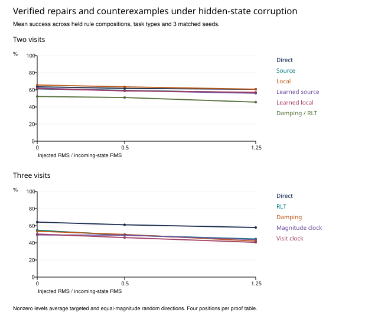

# Source rereading and large-correction clocks

**Keep dense direct recurrence as the reference.** None of four preregistered challengers earned the next scale on this benchmark. Two-pass local rereading and direct scored 60.68% and 60.61% under severe hidden corruption. Source rereading scored 56.51%. At three passes, RLT gained 2.41 percentage points over constant damping, lost on one seed, and finished 13.41 points below direct. The learned magnitude clock produced an informative secondary result across held compositions and also missed its promotion gate.

The 33 dense causal miniatures used three matched seeds, 24,576 proof-row positions per fit and the same initial backbone and input stream within seed. The external verifier requires an exact four-row repair or one valid counterexample. On all held conditions, direct at two visits scored 41.46% on repair and 81.77% on witnesses. Three-pass direct scored 41.15% and 79.69%. Copying the printed conclusion or selecting the first assignment scored 17.19% and 50.00%. Both direct cohorts cleared the separate five-point competence floors. [Protocol](ARCH_PROTOCOL.md)

## Where source access helped

The table gives family-balanced verified success over four held rule compositions and four task types. Nonzero levels average the targeted intervention and its equal-RMS random control. High NLL is the mean binary cross-entropy per truth-table row. Seconds are mean fit wall clock on contended, low-priority CPU cores.

| Two-visit arm | Clean | 0.5× | 1.25× | High NLL | Seconds |
|---|---:|---:|---:|---:|---:|
| Direct | 63.54% | 61.65% | 60.61% | .5715 | 87.5 |
| Constant damping / RLT | 52.21% | 50.98% | 45.64% | .6781 | 92.7 |
| Fixed source | 61.07% | 59.38% | 56.51% | .5720 | 92.0 |
| Fixed local | 65.62% | 63.48% | 60.68% | .5988 | 111.0 |
| Learned source | 61.98% | 58.92% | 55.99% | .6218 | 72.2 |
| Learned local | 61.33% | 58.79% | 57.10% | .5986 | 68.5 |

At high strength, fixed source minus fixed local was **+5.27, −5.86 and −11.91 points** for seeds 137, 163 and 191. Fixed source beat local on two of four held compositions. On corrupted proof repair and wrong-rule repair it scored 35.16% and 31.77%, compared with 47.66% and 38.02% for local. On inconsistent-step and misleading-solution witnesses the corresponding scores were 78.12% and 80.99% for source, 74.74% and 82.29% for local. Replacing the source anchor with the local anchor on the same source-trained weights raised high-strength success from 56.51% to 57.36%.

Learned source minus learned local gave +1.76, −1.17 and −3.91 points. Its learned high-strength reread coefficient averaged .327, compared with .273 for learned local. The source-specific improvement predicted by the registration did not reproduce. These interventions test privileged access to the original prelude alongside the information the recurrent state itself retained. An earlier, independent 21-fit revision probe also found no all-root advantage for fixed source rereading over direct. [Earlier revision probe](https://github.com/MoralityLabAI/DataGoblin/blob/d68c0c7/training/aleph_rlt_placement/SOURCE_REREAD_RESULTS.md)

## Three visits and the size of a correction

| Three-visit arm | Clean | 0.5× | 1.25× | High NLL | Seconds |
|---|---:|---:|---:|---:|---:|
| Direct | 64.19% | 61.07% | 57.88% | .6026 | 48.3 |
| Constant damping | 53.52% | 49.80% | 42.06% | .7281 | 89.3 |
| Whole-pass RLT | 54.69% | 48.96% | 44.47% | .7350 | 73.5 |
| Learned magnitude clock | 49.22% | 48.96% | 43.82% | .7126 | 92.2 |
| Learned visit clock | 50.26% | 46.09% | 40.56% | .7398 | 99.3 |

At high strength RLT minus damping was **+3.32, +4.30 and −0.39 points**. The mean advantage rose from +1.17 clean points to +2.41 high points. It was +4.43 on targeted corruption and +0.39 on random corruption, with positive seed-mean effects on two of four held compositions. Switching RLT-trained checkpoints to constant damping at inference raised high verified success by 0.20 points. Switching damping checkpoints to RLT left aggregate high verified success at 42.06%. The between-fit difference thus includes training adaptation. The two fixed clocks are exactly equivalent at two passes. [Clock and source derivations](ARCH_INTERVENTION.md)

A large injected error did not force a larger recurrent response. For damping, mean second-pass proposal RMS divided by the actual pass-input RMS fell from .268 clean to .253 severe. For RLT it fell from .181 to .170. As an exploratory check, sort the 240 seed × composition × task × condition groups by damping's mean relative proposed displacement over the first two visits. Mean displacement in the four equal-sized groups was .118, .182, .275 and .663. RLT minus damping verified gains were +0.73, −0.94, +0.63 and +3.02 points. The upper group had the largest gain, but the association was nonmonotone. The groups share tasks, examples and weights. The prespecified randomized treatment and held-family results determine the gate.

The magnitude clock exceeded damping by 1.76 points at high strength, with per-seed differences +2.15, −0.78 and +3.91. Against the parameter-matched visit clock it gained +2.34, −0.20 and +7.62 points and led on all four compositions in seed mean. Its second-write coefficient changed from .544 clean to .538 severe. Its first-write coefficient was .570 in both conditions because injection follows the first write. The mean gain over damping missed two points and the paired advantage did not hold on every seed.

## Transport measurements

The first pass is read before the injected perturbation. Later passes use the same final readout without intermediate supervision. On the severe panel, RLT verified success across visits was 50.26% → 42.90% → 44.47%, compared with 48.44% → 40.43% → 42.06% for damping. RLT's relative realized displacements were .060, .085 and .153; damping's were .145, .105 and .222. Successive update cosines were .607 and .992 for RLT, versus .682 and .984 for damping. Final activation RMS was 72.09 for RLT, 75.42 for damping and 66.66 for direct.

An independent centered basis sweep estimated all 128 singular values on four fixed probes per checkpoint and condition. The table gives averages on severe targeted trajectories. These are Jacobians of the proposed core before any clock write. The random-direction measurements average both severe perturbation types over the complete panel.

| Diagnostic, visits 1 / 2 / 3 | RLT | Constant damping |
|---|---|---|
| Basis-sweep operator norm of J−I | 1.46 / 1.30 / 1.24 | 2.16 / 1.57 / 1.36 |
| Basis-sweep operator norm of J | 2.01 / 1.80 / 1.65 | 2.66 / 2.15 / 1.77 |
| Random directional gain | 1.019 / 1.013 / 1.009 | 1.074 / 1.031 / 1.015 |
| Directional curvature proxy | .084 / .058 / .040 | .218 / .075 / .042 |

Halving the finite-difference step on the prespecified sensitivity subset changed the reported norms by at most 0.011% relative. Direct learned a different first-pass map. Its operator norm across 12 clean prelude states had median 91.27 and range 13.89–1,580.00, followed by a mean of 2.34 at the next clean visit. Those local norms identify expansive directions. They do not give the perturbation gain of the full network. All 33 fits completed finite-gradient checks at every update. [Local basis-sweep protocol](ARCH_SPECTRAL_PROTOCOL.md)

## Cost, custody and scope

The four-block proxy has 62,337 unique parameters, plus two for each learned clock or gate. The three-seed matrix processed 811,008 positions in 2,779 summed fit seconds. Per fit, supported eager matrix operations measured 14.43 GFLOPs at two visits and 18.96 GFLOPs at three. The full sum was 0.5441 TFLOPs. Fused attention was missing from the counter. Its QK and AV products add an estimated 5.64–9.02 GFLOPs across the matrix, depending on causal work versus full square tiles; softmax and pointwise operations are outside those numbers. Each fit includes the equal-cost extra, gradient-free foil prelude. The largest sampled resident working set was 264.3 MiB. Host contention varied enough that wall-clock ordering cannot establish a speed advantage.

All 33 checkpoint hashes and matched input/backbone fingerprints verified before the one fresh seed was generated. The global panel has 256 sampled proof tables, reused across strengths, directions and models. Its four ordered operator pairs were withheld from every fit. Two pair names also appeared in the earlier public revision study. The tasks and draws here are distinct. The miniature has four truth-table positions, two central physical blocks per visit, and no language-model loss. These results support retaining direct and damping controls in future independent experiments and holding the paid tournament.

| Receipt | SHA-256 |
|---|---|
| Joined training manifest | `b6495a152dc6969b33c90ac88d96d2473b80406dfaa9c0476d4ec2d9274eba44` |
| All scores and train/inference crossovers | `b127fb7052d4b41fafa4ef770650a4a9d7d0a19ddbab6f94ba14d7cbaf9ea4fb` |
| Basis sweep | `b4a3f788aa1dd9aa3b4f129b1e755bc3c4681b9eae66b3f61ff57da85fff43a0` |
| Private draw commitment | `b07563bba5ed4a12d6d83b56d9c81870db357a8fd222c386617c069a1d90b752` |

Use the [primary protocol](ARCH_PROTOCOL.md) for single-worker replay or the [scoring partition](ARCH_SCORE_PROTOCOL.md) for resumable scoring on released cores. `arch_atlas.py OUT` exports answer-free registry records. `arch_figure.py OUT FIGURE.svg` recreates the chart using ReportLab.
