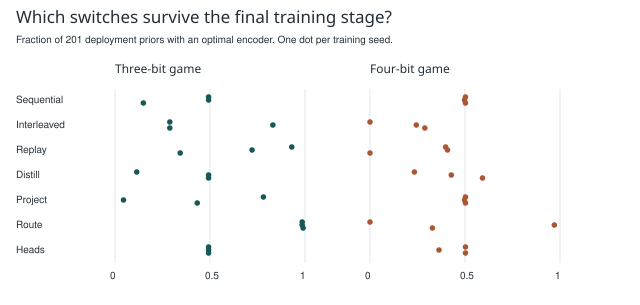

# Can a trained sender keep two parity thresholds and still help an LDT reader?

The routed model kept the original three-bit encoder and readout on all three seeds. Its final encoder was optimal on 98.7% of the 201 priors surrounding the switch at 4/53. Standard sequential training reached 37.8%. The frozen trunk and task-specific adapters preserve the old path. Selecting the old task bypasses both adapters. Four-bit transfer remained weak and fresh LDT deployment failed. No method met all three requirements on any seed.

| Training method | Three-bit bracket, optimal encoder (seeds / 3) | Four-bit bracket, optimal encoder (seeds / 3) | Three-bit grid optimal | Four-bit grid optimal | Fresh LDT actual Brier |
|---|---:|---:|---:|---:|---:|
| Sequential | 0 | 0 | .378 | .501 | .24881 |
| Interleaved | 0 | 0 | .469 | .177 | .23534 |
| Two-item replay per old task | 1 | 0 | .665 | .269 | .23781 |
| Distillation | 0 | 0 | .367 | .418 | .24760 |
| Gradient projection | 0 | 0 | .420 | .501 | .22640 |
| Routed input adapters | 3 | 1 | .987 | .433 | .24317 |
| Modular sender/readout scores | 0 | 0 | .493 | .456 | .25152 |

Each method started at the same three coordinated C checkpoints. Stage one took 240 LDT updates, followed by 180 four-bit updates. Interleaving doubled these update counts. Shared C had 6,880 parameters. Modular scores added 64. The task-ID route froze all 6,880 original weights and added 312 weights across two input adapters. Its linear cost in the number of adapters leaves open whether future skills can reuse a fixed pool. All 42 stage endpoints were saved and scored, alongside midpoint sender probes. The grid samples one continuous deployment axis; its 201 points are strongly dependent.

We enumerated all 32,768 partitions of 16 equally likely worlds up to exchanging message labels, extracted each affine Brier-risk line and verified both sides and the common optimum at 16/667 with integer arithmetic. The test suite independently sums conditional label variance over finite worlds. In the routed arm, one four-bit sender got the entire bracketing sequence right. No routed four-bit receiver passed the joint oracle-and-actual bracket check. Mean four-bit bracket risk was .19759 under ideal decoding and .24716 under its deployed reader. Fresh LDT mean risk was .17553 with an ideal reader of the routed code and .24317 with the actual reader, against .17731 for ideal side alone. The learned side-only matched controls in ALEPH-03 give a separate estimate for frozen original senders.

The practical use for a distributed math gym is to retain the old sender, its decoder and the task selector together. Replay and projection remain measurable challengers. The current results do not establish continual competence at fixed capacity. [Protocol](CONTINUAL_PROTOCOL.md) · [Exact oracle and stage fits](continual_lab.py)
