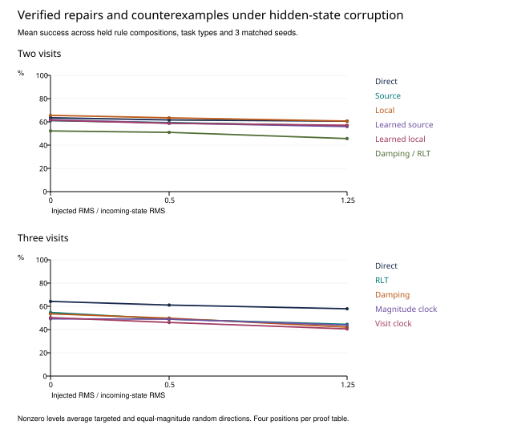
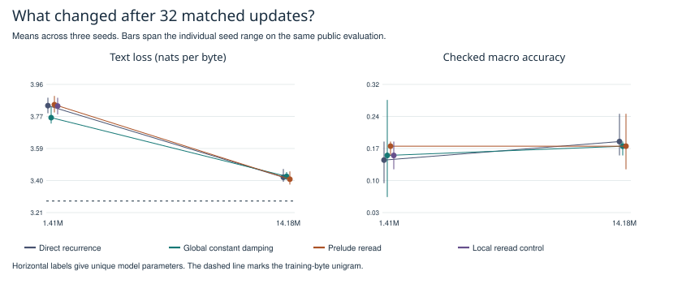
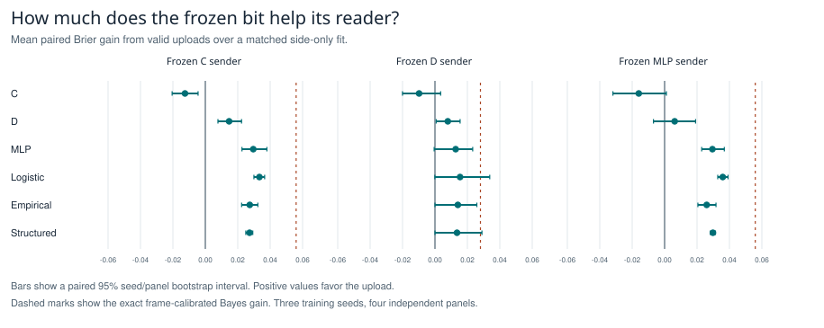

# Data Goblin Aleph · Architecture and distributed researcher tournament

**25 November 2026 · Keep the 10B-token expenditure on hold.** Keep two-pass dense direct recurrence as Aleph A. If reserving a second configuration now, reserve B for **two-pass global constant damping**. B is the strongest simple text control on the longer two-pass native pilot. The intervention still needs to win a fresh, adequately powered comparison on the research tasks. No receipt sender, source gate, learned clock or RLT schedule has earned a paid run from this evidence.

| Question | Decision |
|---|---|
| What should Aleph inherit from Inkling 2 Mini? | A reusable middle with physical weight tying, causal access and separate input and answer processing. Use two visits to keep the initial tournament affordable. |
| Where should mathematical options, LDT and verification live? | Keep them in DataGoblin's existing software. Train the dense model to propose, correct and price receipts. Score the effect its message has on the receiver that actually deploys it. |
| What should enter the next local comparison? | Direct and global damping are anchor arms. Give prelude rereading its same-site control; train a fresh readout whenever a sender looks strong under ideal decoding. |
| What can collaborators contribute now? | Checked counterexamples, finite optimal code tables, calibrated decoders and verified joint contributions. These have measurable value with very small models. |
| What can 1,000 credits buy at the quoted rate? | Two complete 10B checkpoints plus a 5.7B winner extension with a 100-credit reserve. Alternatively, stop a futile challenger at 1B and take the winner to 20B. |

The original placement campaign established physical sharing, equal parameters, causal masking, checkpoint continuation and exact terminal-RLT identity. The new campaign began at the consolidated report, incorporated the later source-reread screen and integrated the existing Model Atlas corpus and Gym Metadata branches. The GPU was heavily occupied when inspected. All new fits used bounded local CPU workers. Training seeds were 137, 163 and 191. A root, mathematical program, family or independent panel is the relevant evaluation unit; multiple token positions from the same problem do not add independent evidence. [Original consolidated report](../aleph_rlt_placement/ALEPH_RESEARCH_REPORT.md) · [Integrated source-reread screen](../aleph_rlt_placement/SOURCE_REREAD_RESULTS.md)

## Dense recurrence and source access

All four promotion gates failed despite competent direct baselines. Direct two-pass Causal Aleph solved 41.46% of exact repairs and 81.77% of witness tasks, versus 17.19% for copying a repair and 50.00% for the fixed witness. The 33 matched fits each processed 24,576 positions. The fresh panel crossed four unseen operator compositions with corrupted proof states, wrong rules, inconsistent claims and misleading proposed solutions. Targeted and random perturbations had matched magnitudes.

| Frozen architecture · verified success | Clean | High corruption |
|---|---:|---:|
| Two-pass direct | 63.54% | 60.61% |
| Two-pass whole-pass damping, algebraically identical to two-pass RLT | 52.21% | 45.64% |
| Fixed prelude read / matched local read | 61.07% / 65.62% | 56.51% / 60.68% |
| Learned source / matched learned local gate | 61.98% / 61.33% | 55.99% / 57.10% |
| Three-pass direct | 64.19% | 57.88% |
| Three-pass whole-pass RLT / matched constant damping | 54.69% / 53.52% | 44.47% / 42.06% |
| Learned magnitude clock / matched visit-only clock | 49.22% / 50.26% | 43.82% / 40.56% |

RLT gained 2.41 percentage points over three-pass damping at high corruption. The three seed differences were +3.32, +4.30 and −0.39 points. It won just two of four unseen compositions and remained 13.41 points behind direct. The magnitude clock gained 1.76 points over damping, below the two-point margin; one seed reversed sign. Fixed source access lost 4.17 points to reading the second pass's local input at the same site. The synthetic study's most reliable architectural lesson is to **preserve direct recurrence as the anchor**. It does not support a special source path or adaptive clock for Aleph. [Perturbation, Jacobian spectra, displacement and same-weight crossovers](ARCH_RESULTS.md)

The measured high-corruption core Jacobians were well away from identity. Mean spectral norms of J−I across successive visits were 1.46, 1.30 and 1.24 for RLT, and 2.16, 1.57 and 1.36 for damping. Yet the RLT advantage was concentrated in targeted perturbations (+4.43 points versus +0.39 on magnitude-matched random directions). It was nonmonotone across quartiles of proposal displacement. Switching RLT-trained weights to damping improved high-corruption accuracy by 0.20 points. Switching damping-trained weights to RLT left it unchanged. A large correction alone did not identify a reason to use the clock.

**Native text and research tasks.** At 1.414M parameters and 192 matched updates, the archived and current direct and global constant implementations produced identical logits and parameter gradients on the audited fixtures. All three seed-level batch plans and the frozen corpus hashes matched. Reported byte NLL is lower-is-better. The checked macro equally weights Lean choice, joint rule revision, repair and counterexample success.

| Native 192-update arm | Byte NLL | Checked macro |
|---|---:|---:|
| Direct | 3.06862 | 20.25% |
| Global constant damping | **2.96774** | 21.56% |
| Prelude reread | 3.05490 | 22.23% |
| Matched same-site damping | 3.06141 | **23.65%** |

Global damping beat prelude on text on every seed. Relative to same-site damping, prelude changed mean byte NLL by −.00651 with individual seed shifts −.03173, −.00191 and +.01411. Its checked macro fell by 1.41 points. The paired public-cluster interval for that checked difference was [−4.42, +1.02] points with training seeds held fixed. The intervals describe this development cohort. The only longer-run advantage particular to source access was a small average language gain, with a seed reversal. [Native replay, hashes and corpus checks](MIXED_REPLAY.md)

**Scale.** Twenty-one fits completed at 1.414M and 14.180M parameters. The 32-update width-80 prefix advanced prelude to the designated 14M calibration rung. At 14M, the direct/global-damping/prelude text means were 3.41582/3.42089/3.40443 versus 3.27565 for the byte unigram. Checked macro was 18.75%/17.71%/17.71%. Neither anchor met the competence rule, so the registered 49.62M and 99.44M cells closed without training. For direct, the slopes of NLL against log parameter count at step 32 were −.1940, −.1734 and −.1824. Earlier prefix slopes were steeper. Wider models improved short-prefix loss with more FLOPs per token; two widths do not identify a 1B scaling law. The three 14M direct CPU rates imply roughly 289–324 single-core-equivalent years of arithmetic for a strict two-pass 10B leg. Optimizer memory alone exceeds the local worker cap. [Scale receipts, throughput and uncertainty](SCALE_RESULTS.md)

## Does a small researcher's message help another model?

Nine C, D and MLP senders were frozen. Each of six reader families received side-only, constant, shuffled and valid fits under the same information constraints. The 216 fits were evaluated on four freshly drawn panels, 64 finite frames covering four containment strata. The primary C→C comparison failed every registered test. Giving it the bit raised Brier loss from .20755 to .22011. Its paired gain was −.01255, with seed/panel bootstrap interval [−.02048, −.00448]. Constant and shuffled controls also beat its valid channel.

For the **same C sender**, a logistic reader gained .03336 and a structured relation-aware reader scored .14177 absolute Brier. Ideal frame-aware value was .05602. Recomputing the oracle using exactly the reader's public observations still left .05073 available. Most of the gap survives removal of hidden frame identity. Across all senders, MLP→structured delivered the best absolute Brier (.13924). Ten of 18 secondary-or-primary pairings passed; all ten were secondary. D seed 191 provided exactly zero channel information. A learned difference of .00081 for its D reader tied constant and shuffle, illustrating why all three controls matter. [Full decoder matrix and uncertainty](DECODER_RESULTS.md)

Let S be the public side information, M the receipt and Y the binary outcome. The Bayes value is the expected square of the posterior change, E[(E[Y|S,M] − E[Y|S])²]. Realized value is Bayes value **plus the side reader's excess risk minus the receipt reader's excess risk**, using the same public conditioning set throughout. A sender and its reader can therefore deserve opposite verdicts. Score a researcher's proposal through both endpoints before allocating it extra training or bandwidth.

## Exact nonlinear separation and actual transfer

The externally verified distributed game has eight independent sites, a late task and an independently verified coordinate. For 16 training objectives and 32 additional transfer objectives, exhaustive search certified an optimal one-bit partition unavailable to GF(2) linear encoders, affine real thresholds, single-coordinate or direct-query shortcuts. Two objectives on the same evidence can require different receipts. The representative Lean theorem checks one objective, both exact finite optima and an endpoint-mixture dominance lemma; the wider family census is Python exhaustive enumeration. [Derivation](NONLINEAR_MATH.md) · [Compiled Lean formalization](https://github.com/MoralityLabAI/Compactification-Theory/commit/f9faf823720cefbbfa0eba476eb2dec0eb51a2fb)

At four uplinks the familiar-program Brier risks were .18993 for side alone, .13264 for the best linear/Bayes team and .11326 for the nonlinear optimum. Objective-aware native LDT matched .11326 here. The objective-blind and random-allocation controls reached .11693 and .13888. D achieved .13059, beating linear on two seeds. C and MLP did so on zero. The gate required three. On unseen programs, C/D/MLP scored .24872/.25463/.24534 against .13585 linear and .11681 exact. Their realized utility per bit relative to their own no-message readers was −.00522/−.00775/+.00047. Local code imitation transferred poorly when the predicate changed. [All four bandwidth budgets, controls and heterogeneous teams](NONLINEAR_RESULTS.md)

**Where a small researcher can add value.** The independent-site game rewards ranking marginal contributions. We constructed an adjacent exact game where that ranking fails. A, B and C each have an independent fair bit. With probability 1/4 the receiver needs C; otherwise it needs A XOR B. Individually A and B have zero value and C is strictly best. With two slots, the greedy pair has Brier loss 3/16 and A+B has 1/16. A researcher can contribute a *verifiable pair* worth 1/8 loss over the greedy allocation without training a larger network. A question for Fable is when a cheap certificate of pairwise gain suffices to approximate the best coalition, after charging for any data-dependent choice of worker identities. [Eight-world counterexample and general threshold](JOINT_QUERY.md)

## Continual mathematical skills

Across seven methods and 42 stage checkpoints, none of the 21 final descendants passed both switch brackets and fresh LDT deployment. Routed C preserved the three-bit 4/53 switch on **3/3** seeds, with 98.7% optimal encoders on the 201-point grid. Sequential C retained the bracket on **0/3** and achieved 37.8% on the grid. Routing added 312 weights to a frozen 6,880-weight trunk and used the task identity. One routed seed selected the four-bit 16/667 encoder on both sides, and none passed its four-bit realized-readout gate. This supports preserving an old skill behind a known selector. It leaves open how to share competence at fixed capacity or infer which skill to invoke. [Seven strategies, actual versus ideal Brier and stage trajectories](CONTINUAL_RESULTS.md)

## From experiments to Aleph's training stream

The release verifies 327 endpoint files, corresponding to 309 distinct checkpoint digests and 360 study roles. Eighteen empirical tables were byte-identical across conditions, and the 33 architecture checkpoints served both ALEPH-01 and ALEPH-02. Nine gym entries include both trained and synthetic studies. The discovery corpus registers every fitted endpoint with its checkpoint identity, architecture, schedule, seed, protocol, verifier, mechanisms and failures. A separate train-only generator turns frozen partners into tasks. It produced 716 verified posterior repairs and 648 costed reader choices across six mathematical families. Of these, 410 receiver forecasts missed by more than ten percentage points and 488 proposed option choices had positive regret. An independent implementation solved all **1,364** printed prompts. Native Aleph read a 2,048-position pack, produced finite gradients on its answer targets and restored the next pack exactly. This is a functioning training interface; any improvement from language-model pretraining on the examples still needs a held-family experiment. [Corpus and custody](CORPUS.md) · [Model and gym index](catalog/README.md)

**Validation.** The repository suite passed 634 tests with 14 skips, and Ruff passed across the checkout. The initial full test run exposed an existing Windows CRLF mismatch in a custody-test fixture. Hashing and writing the same UTF-8 bytes restored the intended split-leakage test. The integrated historical source probe also had existing lint violations. Its reformatted definitions and CLI matched the original syntax trees after normalizing a local variable name. The model-byte join passed Draft 2020-12 validation, and a separate replay reproduced the complete train-only corpus manifest byte for byte.

## Two strict configurations and the budget

Both arms use 999,352,320 unique trainable weights, 24 executed blocks and ten physically shared middle blocks. They use the same grouped-query attention, RoPE, SwiGLU, tied 49,152-token head, data order, optimizer and checkpoint positions. A passes each residual endpoint directly. In provisional B every nonterminal block applies the same fraction of its residual update, approximately .120694 at this depth; the terminal update is full. This is a different intervention from whole-pass damping. The matched three-pass whole-pass RLT and constant schedules differ only at second order for a stationary linear pass. Earlier 14.18M three-pass byte NLL was 2.9579 direct, 2.9196 RLT and 2.9048 matched whole-pass damping. RLT led those two controls on repair (30.6% vs 28.5% and 23.6%), which leaves a task-dependent tradeoff. [Configuration pair](strict_1b_pair.json) · [Clock derivation](ARCH_INTERVENTION.md)

If the operator's estimate of 55 hours and 350 credits per 10B processed nonpadding positions applies to two passes, the three full legs require 1,050 credits. With 100 credits reserved, compare both arms through 10B for 700, then continue the winner by 5.7B for 199.5. If the challenger is stopped for preregistered futility at 1B, a 20B winner and 1B challenger cost 735. At three passes, proportional arithmetic projects 489 credits per 10B. It is a pricing scenario until measured on the actual topology. Preserve the same absolute optimizer clock in both arms; the short extension ends before the existing 16B decay boundary. Measure inclusive throughput, restart fidelity and credits per nonpadding token before allocating a leg. [100M–20B ledger and staged stops](STRICT_1B_BUDGET.md)

**Decision boundary.** The next architecture claim requires independent document, proof and generator families, a paired gain over the strongest prespecified control, at most 1% text degradation, at most two percentage points checked-task regression and at most 10% throughput regression. Freeze production tokenizer and rights-reviewed split manifests first. One 1B training seed per arm can adjudicate the checkpoints purchased; its estimate of architecture-level variance remains limited. [Gates](catalog/gates.json) · [Continuation manifest](continuation.json) · [Reproduction commands](REPLAY.md)
